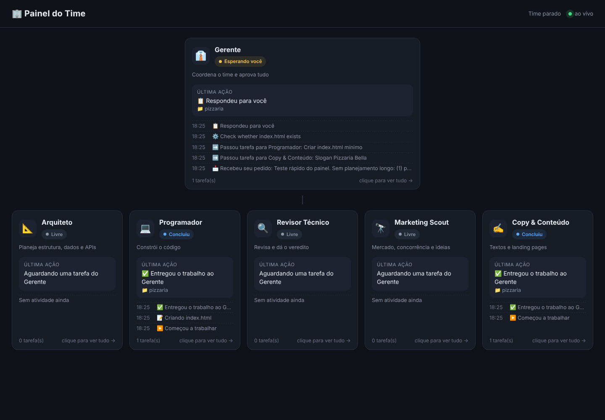

# 🏢 Time de Agentes de IA

Um time fixo de **6 funcionários virtuais** para o Claude Code, focado em **criação, modelagem e adaptação** de sites e sistemas. É o **mesmo time em todos os projetos**: cada projeto entrega o próprio contexto pelo `CLAUDE.md` da pasta.

```
Você (dono)
   └── 👔 Gerente  ← seu único contato; aprova tudo
         ├── 📐 Arquiteto        → define como fazer (não codifica)
         ├── 💻 Programador      → implementa seguindo o Arquiteto
         ├── 🔍 Revisor Técnico  → revisa o código, dá o veredito
         ├── 🔭 Marketing Scout  → mercado, concorrência, ideias (com fontes)
         └── ✍️ Copy & Conteúdo  → textos persuasivos e naturais
```

**Fluxo:** Você → Gerente → Arquiteto (plano) → Programador (código) → Revisor (veredito) → Gerente aprova ou devolve → Relatório para você.

## Skills de cada agente e por quê

| Agente | Skills | Por que essas |
|---|---|---|
| 👔 **Gerente** | `task-coordination-strategies` · `requesting-code-review` · `verification-before-completion` | Quebrar pedidos em tarefas e distribuir; forçar revisão antes de aprovar; nunca dizer "pronto" sem evidência. |
| 📐 **Arquiteto** | `architecture-patterns` · `api-design-principles` · `postgresql-table-design` · `architecture-decision-records` | Estrutura em camadas e padrões; contratos de API; modelagem de banco; registro das decisões técnicas. |
| 💻 **Programador** | `frontend-design` *(Anthropic)* · `responsive-design` · `modern-javascript-patterns` · `nodejs-backend-patterns` · `auth-implementation-patterns` · `systematic-debugging` · `test-driven-development` · `receiving-code-review` · `verification-before-completion` | Visual caprichado e responsivo; JS moderno e back-end Node; login e permissões seguros; bugs pela causa raiz; testes; tratar críticas do Revisor com rigor. |
| 🔍 **Revisor Técnico** | `code-review-excellence` · `multi-reviewer-patterns` · `stride-analysis-patterns` · `auth-implementation-patterns` · `sql-optimization-patterns` · `webapp-testing` *(Anthropic)* · `verification-before-completion` | Revisão com severidade padronizada; análise de ameaças de segurança; checagem de autenticação; consultas lentas; teste real da página no navegador. |
| 🔭 **Marketing Scout** | `competitive-landscape` · `market-sizing-analysis` · `startup-metrics-framework` · `social-evidence-research` | Análise de concorrentes e posicionamento; tamanho de mercado; métricas de negócio; pesquisa em redes com fonte para cada afirmação. |
| ✍️ **Copy & Conteúdo** | `brand-landingpage` · `avoid-ai-writing` · `accessibility-compliance` | Landing pages com identidade de marca; textos sem cara de IA; conteúdo acessível. |

**Origem** (27 skills, todas de código aberto; licenças em `licencas/`):
- [anthropics/skills](https://github.com/anthropics/skills): oficial da Anthropic, Apache 2.0
- [obra/superpowers](https://github.com/obra/superpowers): MIT
- [wshobson/agents](https://github.com/wshobson/agents): MIT

Os 5 especialistas recebem suas skills pré-carregadas (campo `skills:`). O Gerente, por rodar como sessão principal, chama as dele sob demanda.

## 📺 Painel do Time (ver o time e conversar com ele)



O instalador cria o atalho **"Painel do Time"** na Área de Trabalho. Ele liga um pequeno servidor no seu computador (uma janela minimizada, que deve ficar aberta) e abre o painel no navegador em `http://localhost:4747`:

- **Projetos (esquerda):** suas pastas em `C:\Users\<você>\Projetos`. Dá para criar um projeto novo (**+ Novo**), trazer um do GitHub ou do Lovable (**⬇ Do GitHub**), abrir o site (**🌐 Ver site**) ou a pasta (**📂 Abrir pasta**).
- **Time (centro):** 6 quadrados, um por agente, com status, o que está fazendo agora e as últimas ações. Clique num quadrado para ver tudo o que ele fez.
- **Chat (direita):** converse com o **Gerente** sobre o projeto selecionado, como no terminal. Pelo seletor, dá para falar direto com outro agente; nesse caso o trabalho não passa pela aprovação do Gerente.

Cada projeto guarda a própria conversa, então no dia seguinte basta clicar no projeto e continuar. No chat, o Claude trabalha no **modo automático**: faz sozinho o que é de baixo risco e bloqueia ações arriscadas.

**Requisitos:** Git (para os registros do painel) e [Node.js LTS](https://nodejs.org) (para o chat e os projetos). Sem o Node.js, o atalho abre o painel só para visualização.

## Instalar (uma vez, no seu computador)

Requisitos: [Claude Code](https://code.claude.com) atualizado (`claude update`) e Git.

**Mac / Linux / WSL**
```bash
git clone -b claude/awesome-meitner-k6vmym https://github.com/2025foi/teste.git ~/time-de-agentes-repo
~/time-de-agentes-repo/time-de-agentes/instalar.sh
```

**Windows (PowerShell)**
```powershell
git clone -b claude/awesome-meitner-k6vmym https://github.com/2025foi/teste.git $HOME\time-de-agentes-repo
powershell -ExecutionPolicy Bypass -File $HOME\time-de-agentes-repo\time-de-agentes\instalar.ps1
```

Isso copia os agentes para `~/.claude/agents/` e as skills para `~/.claude/skills/`, onde ficam permanentes e valem para qualquer pasta. Se já existir um arquivo com o mesmo nome, o antigo vai para `~/.claude/backup-time-de-agentes-<data>/`.

**Atualizar no futuro:** `~/time-de-agentes-repo/time-de-agentes/atualizar.sh` (no Windows: `git pull` na pasta e rode o `instalar.ps1` de novo).

## Preparar cada projeto

Copie `modelos/CLAUDE.md` para a raiz do projeto e preencha os `[COLCHETES]` (negócio, público, marca, stack, regras, o que não mexer).

## Uso no dia a dia

1. **Entre na pasta do projeto:** `cd ~/meus-projetos/projeto-a`
2. **Chame o Gerente:** `claude --agent gerente`
3. **Peça para ele, como pediria a um gerente de verdade:** *"Quero criar um sistema de agendamento para este cliente. Vê o que os concorrentes oferecem e escreve os textos da página inicial."*
4. **Trocar de projeto:** `/exit`, `cd` para a outra pasta e `claude --agent gerente` de novo. O mesmo time passa a usar o `CLAUDE.md` do novo projeto.
5. **Deu problema?** Fale com o Gerente. Ele investiga, cobra o agente responsável, faz a correção passar pela revisão de novo e te explica o que aconteceu.

**Atalho opcional** (Mac/Linux): `echo "alias equipe='claude --agent gerente'" >> ~/.zshrc` (ou `~/.bashrc`). Depois é só digitar `equipe` na pasta do projeto.

**Gerente como padrão em um projeto:** crie `.claude/settings.json` na pasta do projeto com `{"agent": "gerente"}`. Assim o simples `claude` já abre com o Gerente.
